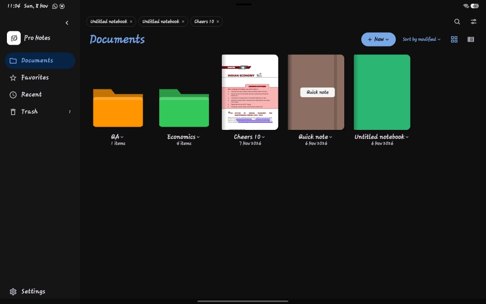
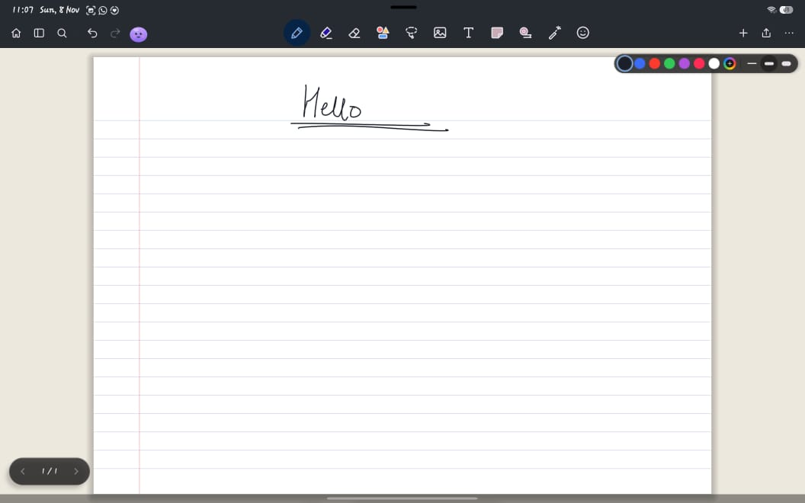
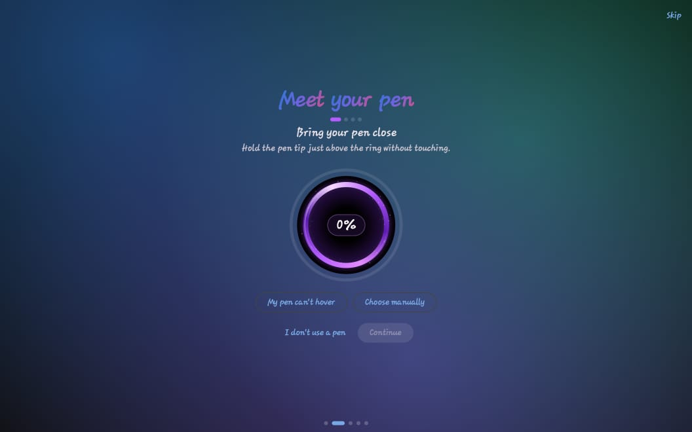
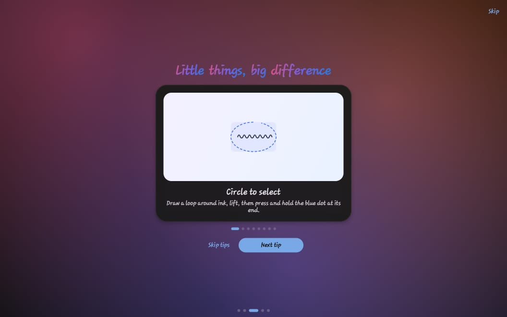
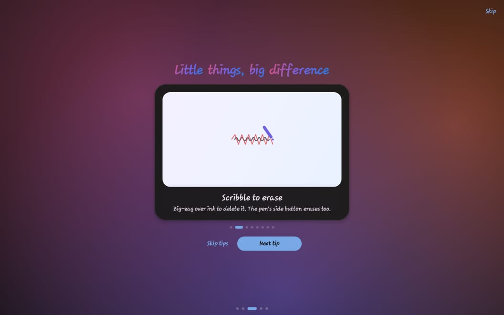
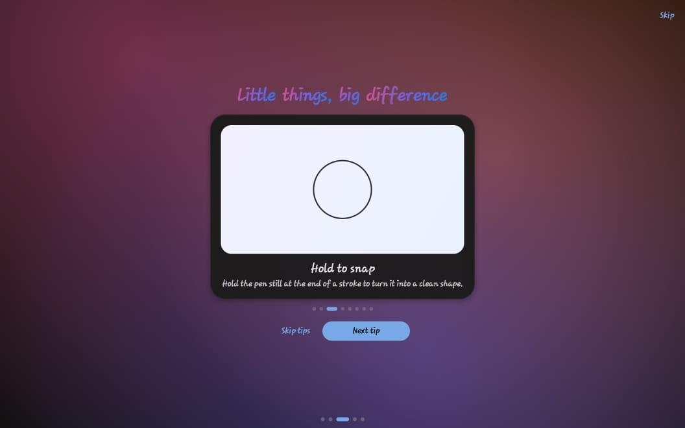
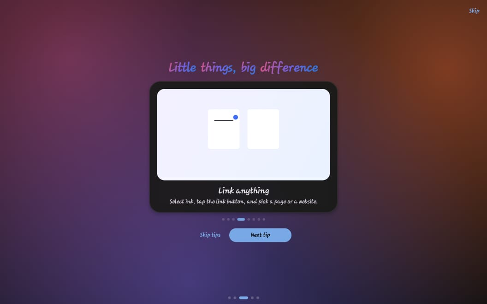
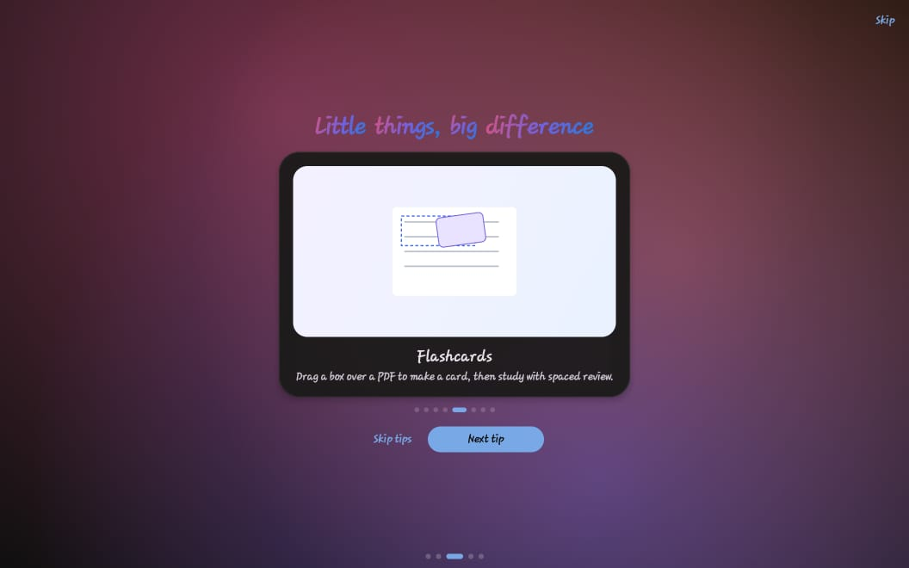
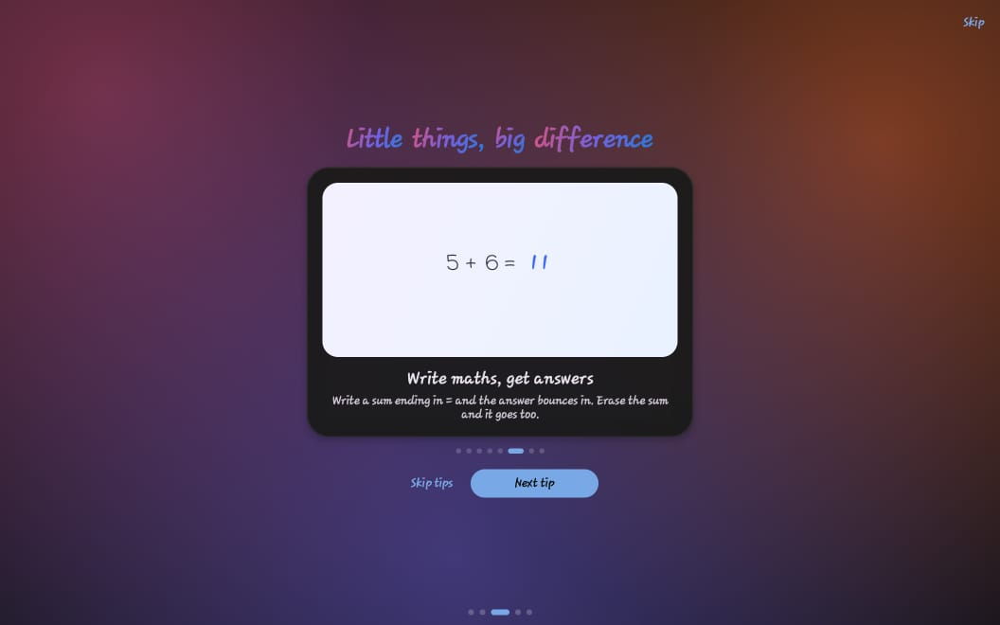
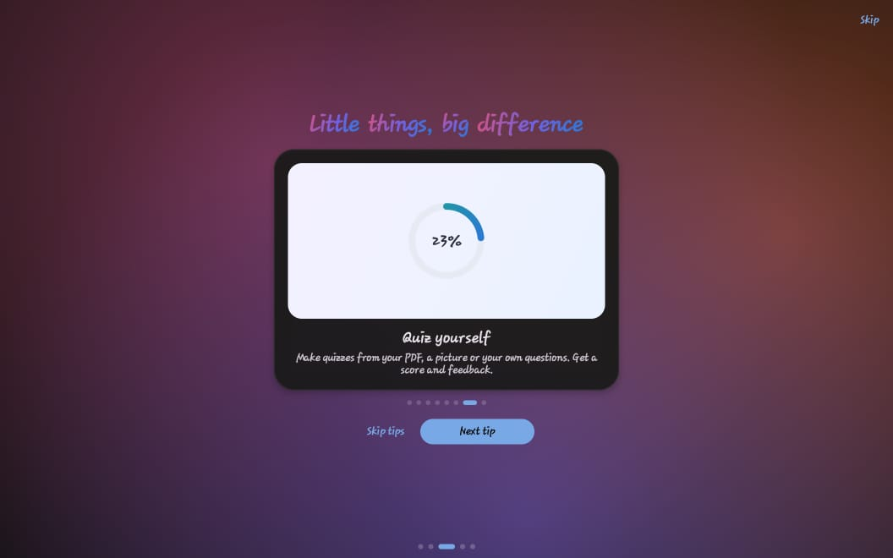

<div align="center">

# Pro Notes

### Your ideas deserve a better workspace.

A thoughtfully crafted space for notes, handwritten ideas, PDF study and everything in between.  
Create freely, stay organised, and make room for focused work on Android.

<br />

<a href="https://github.com/ItzNikk/ProNotes/releases/latest">
  
</a>
<a href="https://github.com/ItzNikk/ProNotes/releases/latest/download/ProNotes.apk">
  
</a>
<a href="LICENSE">
  
</a>


<br />
<br />

<a href="https://github.com/ItzNikk/ProNotes/releases/latest">Get the latest release</a> · <a href="https://github.com/ItzNikk/ProNotes/releases">Release history</a> · <a href="https://github.com/ItzNikk/ProNotes">Explore the source</a>

</div>

---

## A closer look

A focused workspace for handwritten notes, PDF study and the small details that make everyday learning easier.

<div align="center">
  
  <p><sub><strong>Your library.</strong> Keep notebooks, folders and study material organised in one place.</sub></p>
  
  <p><sub><strong>Your workspace.</strong> A clean writing surface with tools close at hand.</sub></p>
</div>

## Get Pro Notes

**[Download the latest APK](https://github.com/ItzNikk/ProNotes/releases/latest/download/ProNotes.apk)** · [Browse all releases](https://github.com/ItzNikk/ProNotes/releases)

Install the APK from a release, then check **Settings → About** for in-app updates. Releases are signed with the same key.

> Always download builds from this repository's official Releases page. Android may ask you to allow installation from your browser or file manager.

## Made for the way you study

Pro Notes brings handwriting, PDF study and notebook organisation together in a native Android workspace.

| Write | Study | Organise |
|:--|:--|:--|
| Natural, pressure-aware ink and a range of pen styles | Import, mark up, search and export PDFs | Folders, notebook covers, bookmarks and page templates |
| Stylus buttons, hover preview and gesture shortcuts | Flashcards cut from PDFs, ink links and a study timer | Customisable toolbar, themes and library backup |

## Features

### Writing that stays out of your way
- Low-latency, pressure-sensitive handwriting powered by Jetpack Ink and motion prediction.
- Fountain, ball, brush and dashed pens, with individual pen settings.
- Samsung S Pen, Wacom, USI 2.0, Lenovo, Xiaomi, Huawei, OnePlus and Microsoft Pen Protocol support.
- Stylus shortcuts: hold the side button to erase or lasso, use the hover radial wheel, and double-click to undo.
- Gesture tools for circle-to-select, scribble-to-erase, hold-to-snap shapes and two-finger undo.
- Lasso and rectangular selection, with move, resize, rotate, flip, recolour, arrange, copy and image sharing.
- Automatic shape recognition, plus 30 drawable shapes with fill and dashed outlines.
- A round-tip highlighter with adjustable opacity and consistent width.

### Smart stylus gestures

A few useful gestures make editing feel more direct. Bring a compatible pen close to the screen to check hover support, circle ink to select it, scribble over strokes to erase, or hold at the end of a stroke to snap it into a clean shape.

<div align="center">
  <table>
    <tr>
      <td align="center" width="50%">
        
        <sub><strong>Meet your pen</strong><br />Check stylus hover support and configure your pen.</sub>
      </td>
      <td align="center" width="50%">
        
        <sub><strong>Circle to select</strong><br />Loop around ink to select it.</sub>
      </td>
    </tr>
    <tr>
      <td align="center" width="50%">
        
        <sub><strong>Scribble to erase</strong><br />Zig-zag over ink to remove it.</sub>
      </td>
      <td align="center" width="50%">
        
        <sub><strong>Hold to snap</strong><br />Hold a stroke briefly to turn it into a clean shape.</sub>
      </td>
    </tr>
  </table>
</div>

### PDFs and pages
- Import PDFs, annotate them, search their text, use dark reading mode, and export or share.
- Vertical or horizontal page navigation, custom page sizes, nine templates and page colours.
- Picture pages, bookmarks and drag-to-reorder page management.
- Large PDFs open fast: a light first pass appears at once, then sharpens, and nearby pages load ahead.

### Study tools
- Flashcards: drag a box over any part of a PDF or your notes, or turn a selection into a card. Spaced review with Again / Good / Easy, a jump back to the source page and CSV export.
- Ink links: connect any two spots in a notebook. Tap the chain badge at one end to jump to the other.
- A study stopwatch you can drag anywhere, with auto-start, idle pause and notebook totals.
- Read-only mode to revise without accidental marks.

<div align="center">
  <table>
    <tr>
      <td align="center" width="50%">
        
        <sub><strong>Link anything</strong><br />Connect ink, pages and external references.</sub>
      </td>
      <td align="center" width="50%">
        
        <sub><strong>Flashcards</strong><br />Turn selected PDF content into study cards.</sub>
      </td>
    </tr>
    <tr>
      <td align="center" width="50%">
        
        <sub><strong>Write maths, get answers</strong><br />Work through handwritten sums with answer assistance.</sub>
      </td>
      <td align="center" width="50%">
        
        <sub><strong>Quiz yourself</strong><br />Create quizzes from PDFs, pictures or your own questions.</sub>
      </td>
    </tr>
  </table>
</div>

### A library that feels like yours
- Colour-coded folders, drag and drop, writable covers and 14 cover materials.
- Favourites, recents, trash and tabs.
- Notebook-specific memory for your last tool, pen, colours, sizes and page.
- Library backup and restore, themes, accent colours and a customisable toolbar.

### Small details for focused work
- In-app updates with release notes and system-installer handoff.
- Pen setup that helps identify and configure your stylus.
- Floating toolbar that can dock to any edge, or an alternate top-bar and side-panel layout.
- Option to hide the toolbar while screen recording.
- Defaults for new notebooks: page size, orientation and cover page.

## Compatibility

- **Android:** 8.0 (API 26) or newer.
- **Devices:** designed with tablets in mind; also works on phones.
- **Background blur:** requires Android 12 or newer for the real blur effect.
- **Build environment:** JDK 17 and Android SDK API 36.

## Build from source

```bash
git clone https://github.com/ItzNikk/ProNotes.git
cd ProNotes
gradle assembleRelease
```

CI builds on pushes to the repository. Version tags such as `v6.0.0` publish a GitHub Release, using [CHANGELOG.md](CHANGELOG.md) for release notes.

Optional: set `pronotes.upi` in `gradle.properties` (or `SUPPORT_UPI` in CI) to enable the in-app support screen.

## Built with

[Jetpack Compose](https://developer.android.com/compose) · [Jetpack Ink](https://developer.android.com/develop/ui/compose/touch-input/stylus-input/ink-api) · Jetpack Graphics Shapes · PdfBox-Android · Coil · colorpicker-compose · Reorderable · kotlinx.serialization

---

## A note from the developer

Pro Notes is an independent project built and maintained by a student. Studies and other responsibilities come first, so development may be intermittent and replies to issues or pull requests may take time. Please do not expect a full-time response schedule or guaranteed turnaround.

This project is shared as a gift to students and learners who want a capable, open-source notebook without a barrier to getting started. Use it, learn from it, and make the most of it.

## Forks, reuse and attribution

You are welcome to **fork Pro Notes, study the source, adapt it and build your own version** under the terms of the Apache License 2.0.

Please preserve the original copyright and licence notices, include the [NOTICE](NOTICE) file in redistributed copies, and give clear credit to the original project. A suitable attribution is:

> Based on Pro Notes by ItzNikk — https://github.com/ItzNikk/ProNotes

The **Pro Notes** name and app icon identify the original project; please do not use them to endorse or brand a derived app without prior written permission. See [LICENSE](LICENSE) and [NOTICE](NOTICE) for the applicable terms.

---

<div align="center">

**Made by a student, shared with students.**

[Download](https://github.com/ItzNikk/ProNotes/releases/latest) · [Source code](https://github.com/ItzNikk/ProNotes) · [Changelog](CHANGELOG.md)

</div>
