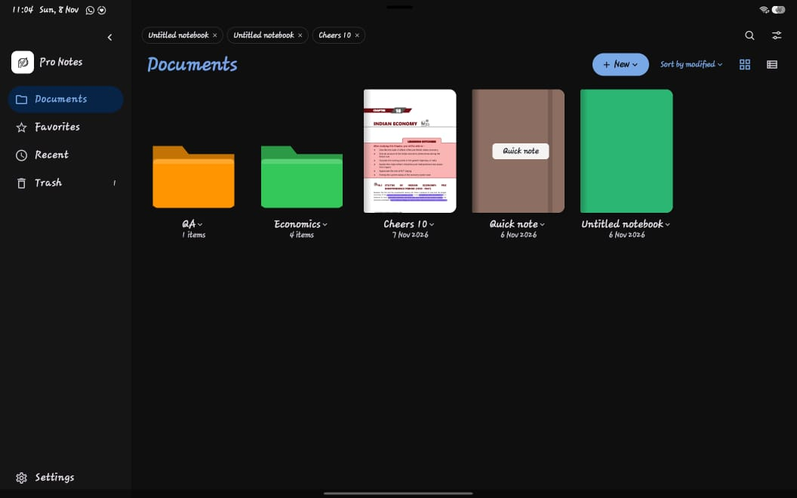
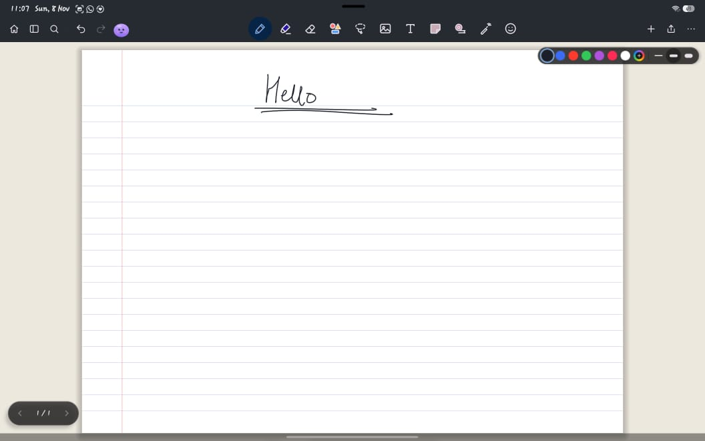
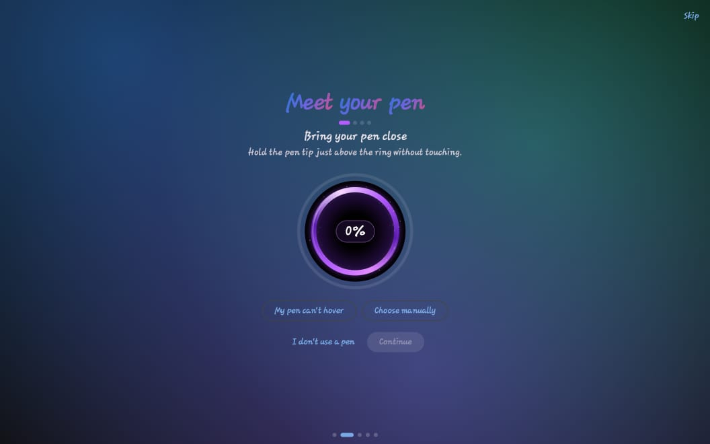
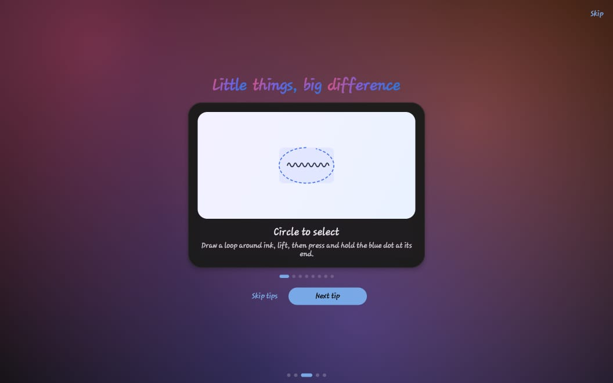
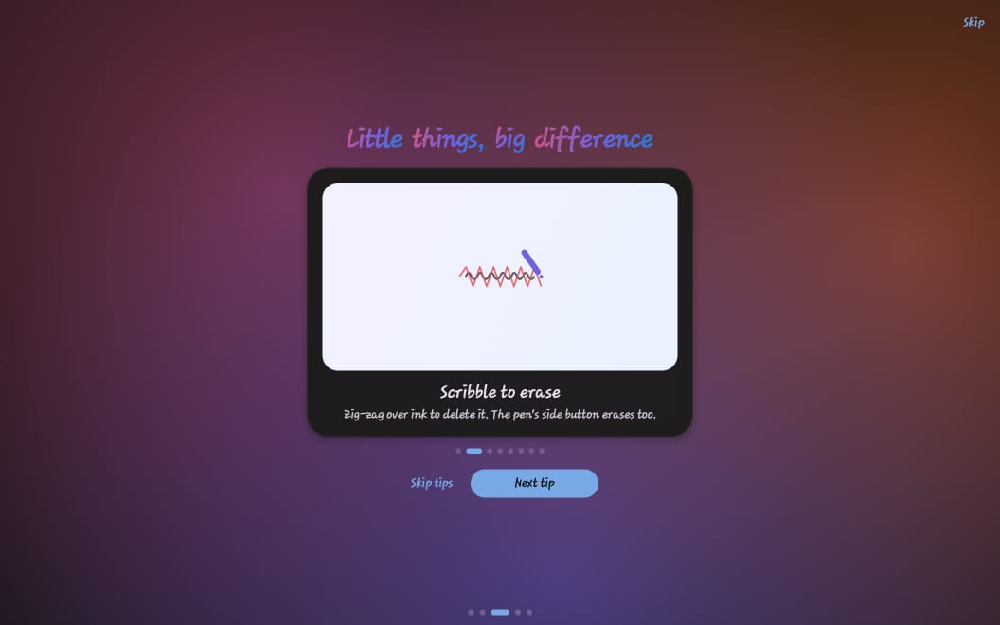
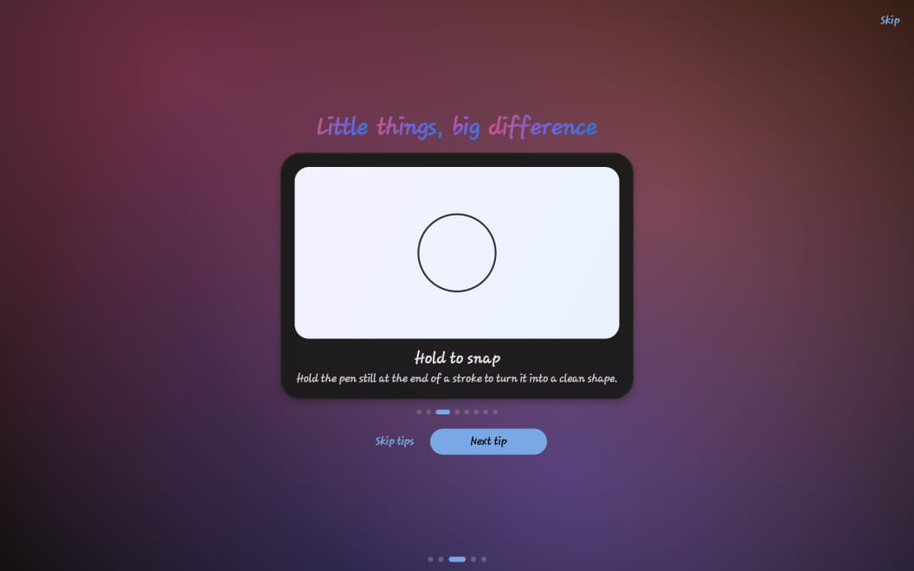
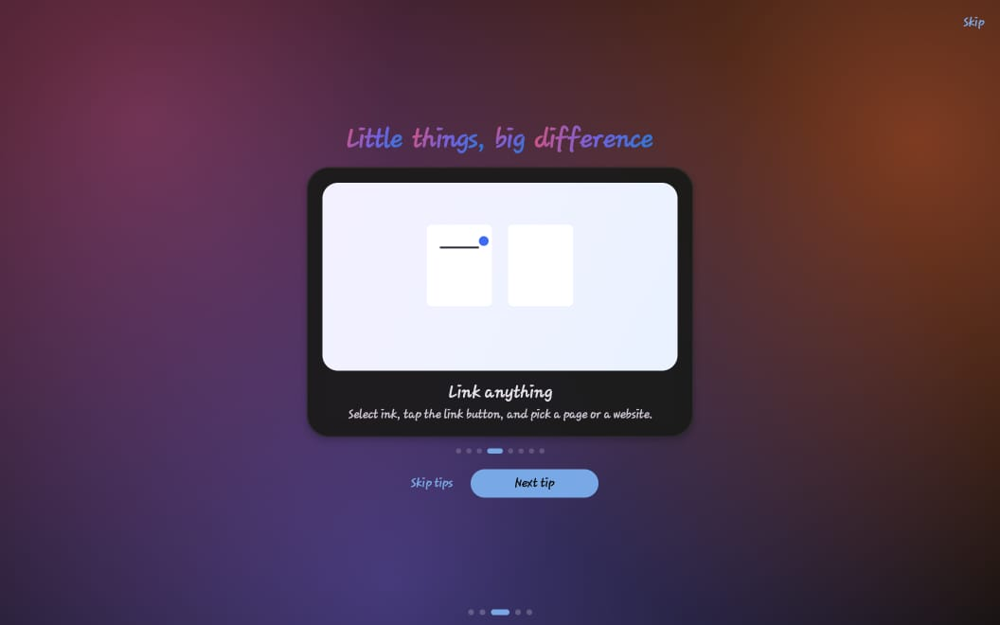
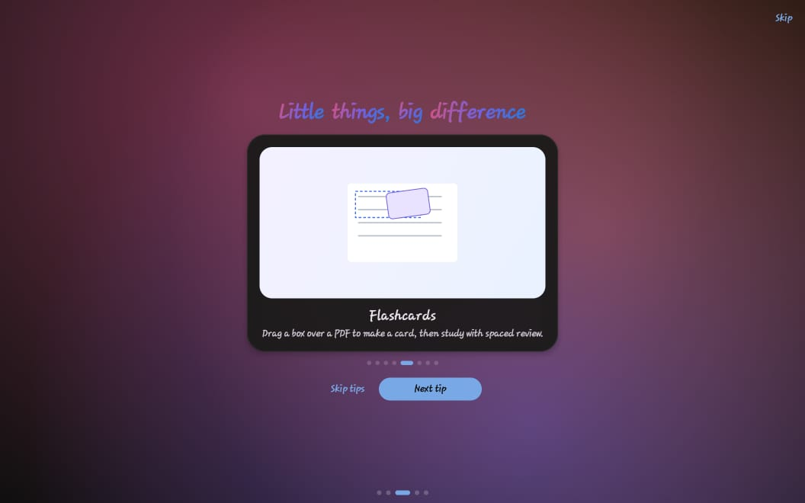

<div align="center">

# Pro Notes

**A handwriting, PDF annotation, and study workspace for Android tablets and phones.**

[](https://github.com/ItzNikk/ProNotes/releases/latest)
[](https://github.com/ItzNikk/ProNotes/releases/latest/download/ProNotes.apk)
[](LICENSE)


[Latest release](https://github.com/ItzNikk/ProNotes/releases/latest) · [Release history](https://github.com/ItzNikk/ProNotes/releases) · [Architecture](docs/ARCHITECTURE.md) · [Changelog](CHANGELOG.md)

</div>

---

## Overview

Pro Notes brings low-latency handwriting, document annotation, and structured study tools together in a native Kotlin and Jetpack Compose workspace designed for styluses and tablets.

<div align="center">
  
  <p><sub><strong>Library.</strong> Organise notebooks, folders, tags, and imported documents in one workspace.</sub></p>
  
  <p><sub><strong>Editor.</strong> Write naturally with pen tools, page templates, and a customisable toolbar.</sub></p>
</div>

## Installation

1. Download the latest APK from [Releases](https://github.com/ItzNikk/ProNotes/releases/latest).
2. Install the APK on your Android device (Android 8.0 or newer).
3. Use **Settings → About** for resumable in-app updates signed with the same key.

## Core Features

### Handwriting and Canvas
- **Low-latency ink:** Calibrated pressure- and tilt-aware strokes built on Jetpack Ink and `input-motionprediction` with low-pass EMA smoothing for S Pen, Wacom, and USI 2.0 styluses.
- **Pens, crayon, and highlighter:** Fountain, ball, brush, dashed pen, and procedural paper-grain **Crayon** presets, plus a round-tip highlighter with adjustable opacity and layer blending.
- **Stylus support & palm rejection:** Hover-aware palm rejection (large-contact filtering + Android `FLAG_CANCELED`), reliable side-button erase/selection, double-click undo, and the **Quick Actions** radial arc (with 1-tap Auto-Text and Keyboard Mode).
- **Gestures:** Circle-to-select, scribble-to-erase with theme-blended gradient particles (rejects numbers & cursive), **double-tap ink to convert to text**, hold-to-snap shapes, and two-finger undo / three-finger redo.
- **Cross-page Selection (Lasso):** Thick dashed freeform and rectangular selection with **cross-page drag-and-drop**, move, resize, rotate, flip, recolour, layering, copy/paste, and image export.
- **Shapes and geometry:** Automatic shape recognition (including single-stroke arrows) alongside 30 preset shapes with fill and dashed outline controls.

<div align="center">
  <table>
    <tr>
      <td align="center" width="50%">
        
        <sub><strong>Stylus setup</strong><br />Detect stylus hover and configure button shortcuts.</sub>
      </td>
      <td align="center" width="50%">
        
        <sub><strong>Selection (Lasso)</strong><br />Draw a closed loop around content to select it.</sub>
      </td>
    </tr>
    <tr>
      <td align="center" width="50%">
        
        <sub><strong>Scribble to erase</strong><br />Zig-zag across strokes to remove them.</sub>
      </td>
      <td align="center" width="50%">
        
        <sub><strong>Hold to snap</strong><br />Pause at the end of a stroke to snap into a clean shape.</sub>
      </td>
    </tr>
  </table>
</div>

### Keyboard Mode, Sticky Notes, and Stickers
- **Direct-on-Page Keyboard Mode:** Distraction-free inline typing directly on the paper with zero box chrome or placeholders — tap anywhere on the page to place the blinking caret snapped to ruled, Seyès, Cornell, or grid lines, with hardware keyboard ergonomics (`Enter` checklist/list continuation, `Tab`/`Shift+Tab` indent, `Ctrl+B/I/U`, `Ctrl+Z/Y`, `Esc`).
- **Write Box & Auto-Text:** Write with a stylus or finger and convert strokes to editable typed text in place, or double-tap any handwritten line to convert it immediately.
- **In-Place Sticky Notes & Presets:** Edit sticky notes directly on the canvas with Plain, Lined, Grid, or Dotted textures and 1-tap saved custom presets.
- **Vector Stickers & Background Erase:** 6 categories of crisp vector stickers (**Study**, **Planner**, **Arrows**, **Badges**, **Icons**, **Minimal**) plus offline CIE-perceptual subject cutout that removes backgrounds and enclosed pockets with edge de-fringing.
- **Granular Eraser Filters:** Target any combination of pen ink, highlighter, shapes, text and Write Boxes, stickies and tape, or images.

### Documents, Reader Mode, and Study Tools
- **Multi-format import:** Import PDF, Word (`.docx`, `.doc`, `.odt`, `.rtf`), PowerPoint (`.pptx`, `.ppt`, `.odp`), spreadsheets (`.xlsx`, `.xls`, `.ods`, `.csv`, `.tsv`), EPUB books, Markdown, plain text, and images.
- **Reader Mode:** Dedicated page-turn reading space with single-page and two-page tablet spread layouts, Paper/Sepia/Night themes, page-turn animations, progress scrubber, and optional paper-turn audio.
- **Flashcards & Quiz:** Create cards from page regions, selections, or structured notes; study with 3D perspective flip cards, `Again / Hard / Good / Easy` spaced-repetition rating (with `Space` & `1`–`4` keyboard shortcuts), responsive tablet multiple-choice Quiz mode, hints, starred filters, and CSV export.
- **Concept Maps:** Build node-and-branch diagrams on the page with radial, tree, and org-chart auto-layouts, subtree dragging, outline export, and flashcard conversion.
- **Split View, Ink Links, and Study Timer:** Study two notes side by side with pan/zoom and writing tools, connect related regions across pages, attach Link Previews, collaborate in shared study rooms, or track sessions with a stopwatch or Pomodoro countdown.

<div align="center">
  <table>
    <tr>
      <td align="center" width="50%">
        
        <sub><strong>Ink links</strong><br />Connect related regions across pages or open external references.</sub>
      </td>
      <td align="center" width="50%">
        
        <sub><strong>Flashcards</strong><br />Capture sections from notes or PDFs into spaced-repetition cards.</sub>
      </td>
    </tr>
  </table>
</div>

### Library and Appearance
- Colour-coded folders with nested breadcrumbs, custom device storage folder sync, drag-and-drop organisation, tags, favourites, trash, custom notebook covers, and library backup/restore.
- Eight switchable UI colour schemes, light/dark/system modes, customisable corner roundness, hardware-accelerated **Haze** progressive scroll blur, 25+ downloadable UI languages (with automatic RTL), and dockable toolbars (`Top`, `Bottom`, `Left`, `Right`, or `Floating`).

## Compatibility and Building

- **Runtime:** Android 8.0 (API 26) or newer (target SDK 36).
- **Build toolchain:** JDK 17, Gradle 8.13+, Android SDK API 36.

```bash
git clone https://github.com/ItzNikk/ProNotes.git
cd ProNotes
./gradlew assembleRelease
```

Optional build properties in `gradle.properties` or environment variables:
- `SUPPORT_UPI` / `SUPPORT_UPI_NAME` (`pronotes.upi` / `pronotes.upiName`): enables optional UPI support on the Support screen.
- `CLOUD_PROJECT_ID`, `CLOUD_DB_ID`, `CLOUD_API_KEY`, `GOOGLE_CLIENT_ID`: configures optional custom sync credentials.

## Project Structure

See [docs/ARCHITECTURE.md](docs/ARCHITECTURE.md) for the module and package layout.

## Technology Stack

- [Jetpack Compose](https://developer.android.com/compose) (`2025.10.00` BOM) & Material 3
- [Jetpack Ink](https://developer.android.com/develop/ui/compose/touch-input/stylus-input/ink-api) & `androidx.input:input-motionprediction`
- [Haze](https://github.com/chrisbanes/haze) (`RenderEffect` progressive surface blur)
- ML Kit Digital Ink Recognition (58+ offline handwriting languages)
- Jetpack Graphics Shapes
- PdfBox-Android
- Coil 3
- Reorderable
- colorpicker-compose
- kotlinx.serialization & kotlinx.coroutines

## Licence and Attribution

Pro Notes is licensed under the **Apache License 2.0**. See [LICENSE](LICENSE) and [NOTICE](NOTICE) for full terms and third-party attributions.

Derived works must preserve copyright notices and include [NOTICE](NOTICE) with credit:

> Based on Pro Notes by ItzNikk — https://github.com/ItzNikk/ProNotes
